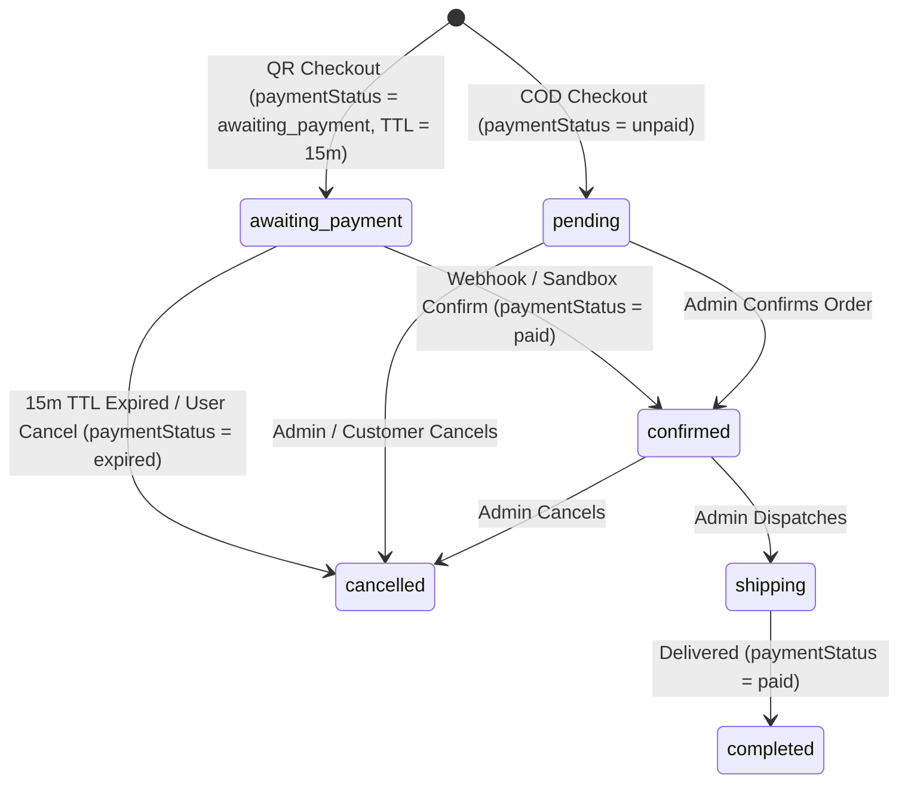

# Research: State Machine & Polling Strategy for Simulated QR Payment

**Ticket**: [Research: State Machine & Polling Strategy for Simulated QR Payment](https://github.com/FeurisPT2/phone-store-node/issues/4)  
**Part of**: [Wayfinder Map: TechStore v2.0 Production-Ready System & UI Completion](https://github.com/FeurisPT2/phone-store-node/issues/3)

---

## 1. Context & Primary Sources

### Existing Codebase Architecture
- **Order Model**: `src/models/Order.js` currently supports dual persistence (PostgreSQL `orders` table and `src/data/orders.json` via `JsonDB`).
- **Current Order Schema (`src/models/Order.js#L6-L21`)**:
  - `id`: `'ORD_' + Date.now()`
  - `customerId`, `customerInfo`, `items`, `totalAmount`, `status`, `adminNote`, `note`, `statusHistory`, `createdAt`, `updatedAt`.
  - Valid statuses currently hardcoded at `src/models/Order.js#L146`: `['pending', 'shipping', 'completed', 'cancelled']`.
- **Order Controller**: `src/controllers/orderController.js` creates an order directly with `status: 'pending'` and immediately clears `req.session.cart`.

### Industry Standards Referenced
- **VietQR / NAPAS 247 Dynamic QR Specification**: Dynamic QR codes encode transaction reference (`paymentRef`), amount (`totalAmount`), and merchant account info, with a bounded validity window (typically 15 minutes).
- **VNPay / MoMo IPN (Instant Payment Notification) Webhook Pattern**: Asynchronous server-to-server webhook callback paired with client-side short-interval status polling (`GET /api/orders/:id/payment-status`).

---

## 2. Order & Payment State Machine Design

To avoid splitting payment state into a separate table while maintaining full compatibility with both PostgreSQL and `JsonDB`, we extend the `Order` record with payment metadata fields:
- `paymentMethod`: `'cod' | 'qr'` (default `'cod'`)
- `paymentStatus`: `'unpaid' | 'awaiting_payment' | 'paid' | 'expired' | 'failed'`
- `paymentRef`: `'PAY_' + orderId` (unique reference for QR code & webhook reconciliation)
- `paymentExpiresAt`: ISO timestamp (`createdAt + 15 minutes` for `'qr'`, `null` for `'cod'`)

### State Transition Matrix

| Order `status` | `paymentMethod` | `paymentStatus` | Trigger |
| :--- | :--- | :--- | :--- |
| `awaiting_payment` | `qr` | `awaiting_payment` | Customer submits checkout with QR method (`VNPay` / `MoMo`). |
| `confirmed` | `qr` | `paid` | Sandbox webhook (`POST /api/payments/sandbox-webhook`) or simulated confirmation received before `paymentExpiresAt`. |
| `cancelled` | `qr` | `expired` | Lazy evaluation on poll or status check when `Date.now() > Date.parse(paymentExpiresAt)`. |
| `pending` | `cod` | `unpaid` | Customer submits checkout with COD method. |
| `completed` | `cod` / `qr` | `paid` | Order delivered; `CustomerModel.syncOrderStats` is credited upon completion. |

---

## 3. Expiration Handling: Lazy TTL Evaluation vs Background Timers

### Findings
- **In-Process `setTimeout` Drawbacks**: Lost on server restart, leaks memory in tests (`node --test`), and fails across serverless or multi-process deployments.
- **Recommended Pattern — Lazy TTL Evaluation on Read + Poll**:
  Whenever `OrderModel.findById(id)` or `GET /api/orders/:id/payment-status` is called:
  1. Check if `order.paymentStatus === 'awaiting_payment'` and `order.paymentExpiresAt && new Date() > new Date(order.paymentExpiresAt)`.
  2. If expired, atomically transition `order.paymentStatus = 'expired'` and `order.status = 'cancelled'`, appending a `statusHistory` entry: `"Quá hạn thanh toán QR (15 phút)"`.
  3. Return the updated order state immediately to the polling client.

---

## 4. Client-Server Communication: Polling vs SSE/WebSockets

### Comparison
1. **Short-Interval HTTP Polling (`GET /api/orders/:id/payment-status` every 3s)**:
   - Works identically across Express, reverse proxies, and serverless environments.
   - Trivial to test deterministically with `supertest` / `fetch`.
   - Negligible load: 15 minutes max = at most 300 lightweight JSON reads by a single active checkout session.
2. **Server-Sent Events (SSE) / WebSockets**:
   - Holds open persistent HTTP connections; complicates session middleware and graceful shutdown in tests.

### Decision Recommendation
- **Use 3-second HTTP Polling** on the client modal (`GET /api/orders/:id/payment-status`), paired with a countdown timer rendered from `paymentExpiresAt`.
- Provide `POST /api/payments/sandbox-webhook` accepting `{ orderId, paymentRef, action: 'confirm' | 'cancel' }` so both automated integration tests and the Frontend Sandbox UI ("Giả lập quét QR thành công" button) can trigger instant state transitions.
